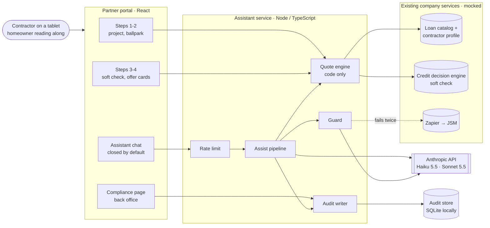
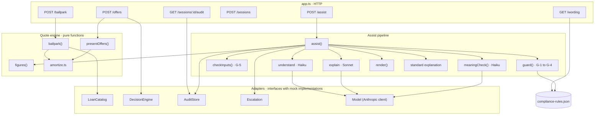
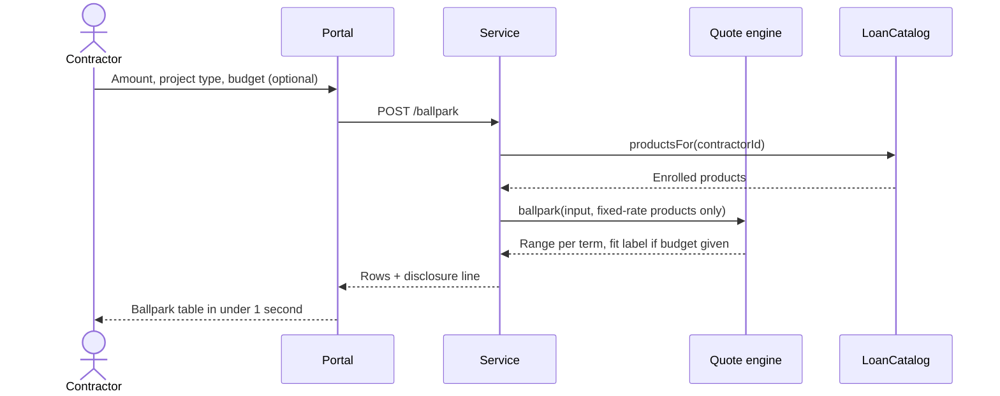
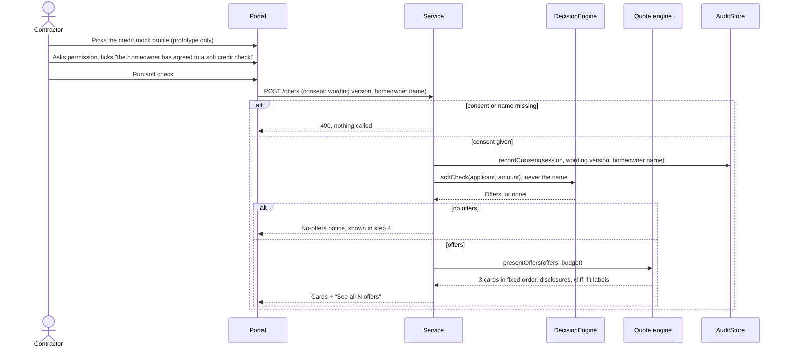
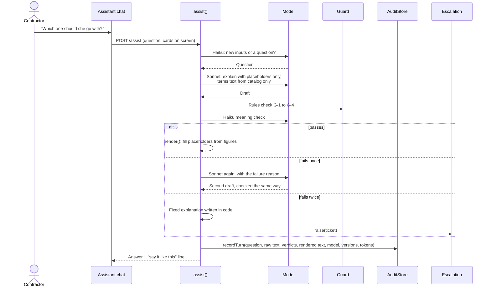
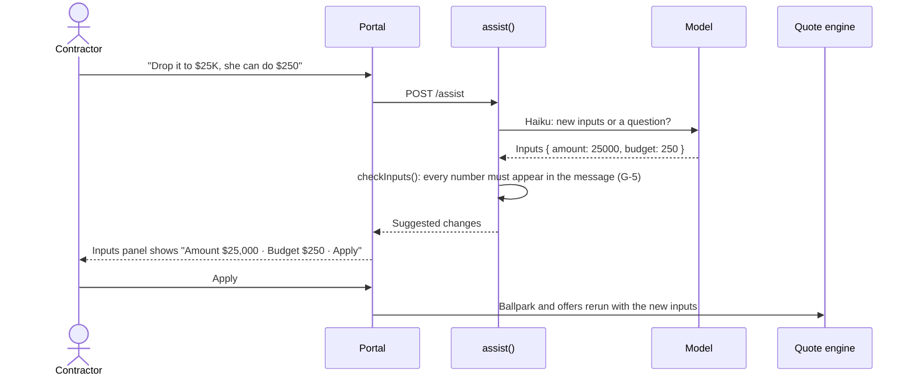

# Architecture

How the on-site financing assistant is built. Requirements and IDs (FR-, G-, NG-) are in [PRD.md](PRD.md).

**Two rules shape everything below:**
- Numbers come only from code. The model explains; the quote engine calculates.
- The AI can suggest; only the contractor applies. The cards work with the AI switched off.

## 1. High-level architecture



| Box | Prototype | Production |
|---|---|---|
| Partner portal | React + Vite app | Panel inside the existing portal |
| Assistant service | Express in Docker | ECS Fargate service |
| Catalog, profile, decision engine | In-process mocks, same interfaces | Existing internal APIs |
| Audit log | SQLite tables, append-only by trigger ([data-model.md](data-model.md)) | RDS Postgres (append-only) + S3 Object Lock |
| Zapier → JSM | Stub that logs the ticket | Zapier webhook to Jira Service Management |
| Anthropic API | Real calls | Real calls, key in Secrets Manager |

### Runtime: everything runs in Docker

Nothing runs on the host: not the app, not the tests, not the evals. One `docker compose` file defines every service.

| Service | What it runs | Command |
|---|---|---|
| `api` | Express assistant service | `docker compose up` |
| `web` | React app (Vite build) | `docker compose up` |
| `test` | Server unit and integration tests (Vitest), no API key needed | `docker compose run --rm test` |
| `web-test` | Web component and App tests (Vitest) | `docker compose run --rm web-test` |
| `evals` | Eval suite against the real model | `docker compose run --rm evals` |

The only thing needed on the host is Docker, plus an `ANTHROPIC_API_KEY` in `.env` for the app and evals.

## 2. Low-level architecture

Each module is one file with one job. **Bold** interfaces are the test seams.



### Interfaces

```ts
// Adapters: the mock and the real service implement the same interface.
interface LoanCatalog {
  version: string;
  productsFor(contractorId: string): Product[];        // enrolled products only
}
interface DecisionEngine {
  softCheck(req: { applicantRef: string; amount: number }): Promise<Offer[]>;  // [] means no offers
}
// AuditStore (SQLite, append-only): ensureSession, recordConsent, recordOfferSet, recordTurn, sessionTrail.
// Tables and columns: docs/data-model.md
interface Escalation { raise(ticket: { reason: string; turnId: string }): void }

// Quote engine: pure, no I/O, no model.
function ballpark(input: { amount: number; budget?: number }, products: Product[]): BallparkResult;
//   -> { ok: true, aprMin, aprMax, rows } | { ok: false, reason: "amount_out_of_range" | "no_products" }
function presentOffers(offers: Offer[], budget?: number): { cards: Card[]; allOffers: DisclosedOffer[]; totalCount: number };
function figures(cards: Card[]): Figures;   // "lowest_monthly.monthly" -> "$289.31"; lifetime totals also get ".rounded"

// Assist pipeline.
function guard(draft: Draft, screen: Screen): { pass: boolean; failures: Failure[] };  // G-1 to G-4, deterministic
//   Draft = { answer, say }   Screen = { figures, promoOnScreen }   rules: compliance-rules.json
function checkInputs(message: string, suggested: SuggestedInputs): { inputs: SuggestedInputs; dropped: ("amount" | "budget")[] }; // G-5
function render(text: string, figures: Figures): string;   // render.ts also owns the {{placeholder}} syntax
function assist(req: { sessionId; contractorId; message }, deps: { model, audit, catalog, escalate }): Promise<AssistResult>;
//   AssistResult = suggestion { inputs, dropped } | answer { outcome, answer, say } | unavailable { message }
interface Model {   // anthropicModel.ts: Haiku 5.5 (understand, meaningCheck), Sonnet 5.5 (explain)
  understand(message): Understanding;        // inputs | question | credit_decision | off_topic
  explain(request: ExplainRequest): Draft;   // { answer, say } with {{placeholders}}
  meaningCheck(draft): MeaningVerdict;       // { pass, quote, reason }
}
```

### Test seams

| Seam | Tested with | Faked at the boundary |
|---|---|---|
| `ballpark()`, `presentOffers()`, `figures()` | Worked examples (known amortization values) | Nothing: pure functions |
| `guard()`, `checkInputs()`, `render()` | Pass and fail drafts per rule | Nothing: pure functions |
| `assist()` | Lane routing, retry, fallback, audit record | `Model`, `AuditStore`, `Escalation` |
| HTTP routes | Consent required, rate limit, status codes | Adapters |
| Real model behaviour | Eval suite | Nothing: real API calls |

## 3. Sequence diagrams

### 3.1 Ballpark: no homeowner data, no AI



### 3.2 Consent and soft check: real offers



### 3.3 Assistant question: explain, guard, retry, render



### 3.4 Chat with new numbers: the AI suggests, the contractor applies



## 4. Build plan

Built in vertical slices, test-first. Each slice is a GitLab merge request: built on a branch, reviewed on two axes (coding standards, and the spec in [PRD.md](PRD.md)), fixed test-first, then squash-merged. The review findings and their fixes stay in the merge request.

| # | Slice | Seams under test | Status |
|---|---|---|---|
| 1 | Quote engine: payment maths, ballpark, budget fit, three cards, cliff, disclosures, figures | `ballpark()`, `presentOffers()`, `figures()` | Done (`0b7c51e`) |
| 2 | Guard and render: placeholders, G-1 to G-5 rule checks, compliance rules file | `render()`, `guard()`, `checkInputs()` | Done (MR 1) |
| 3 | Decision engine mock, consent, audit store | `POST /sessions`, `/offers`, `/ballpark`, `GET /sessions/:id/audit` | Done (MR 2) |
| 4 | AI steps: understand, explain, meaning check, retry and fallback | `assist()` with the model faked at the boundary | Done (MR 3) |
| 5 | API wiring, rate limit, server and Docker runtime | `POST /api/assist`, `GET /health` | Done (MR 4) |
| 6 | React UI: inputs panel, ballpark, soft check, cards, assistant panel, compliance view | Component and App tests plus a browser smoke run | Done (MR 5) |
| 7 | Evals and grounding against the real models | `docker compose run --rm evals` | Done (MR 6); live run needs an API key |
| 8 | Docker run, README, design doc, evals report | `docker compose up` | Done (MR 7) |
| 9 | Guided screen (homeowner name, four steps, next line, starter questions) and the compliance page (checklist and timeline) | App and audit-summary tests, the name on the consent route, a browser run, eval run 5 | Done (MR 9) |
| 10 | Fixes ISS-7, ISS-8, ISS-9 (figure meanings in the explain prompt, named offers, rounded total difference) | `prompts.test.ts`, `quote.test.ts`, eval run 6 | Done (MR 10) |
| 11 | Eval trace: every question keeps its drafts, checks and block reasons; `EVAL_SET` runs one case set | `graders.test.ts`, eval run 7 | Done (MR 11) |
| 12 | Two fixed columns (steps, 360px assistant rail); the assistant as a chat with prompt bubbles | App and AssistantPanel tests | Done (MR 12) |
| 13 | Fix ISS-10 (no promises in the spoken line; explain@10, meaning@7) | `prompts.test.ts`; eval run 8 (MR 16) | Done (MR 13) |
| 14 | Colour of the "Next" line | None (styles only) | Done (MR 14) |
| 15 | Fix ISS-11 (switching the credit mock profile clears the result); step 3 in the order it's done | `App.test.tsx` | Done (MR 15) |
| 16 | Eval run 8 record | `docs/EVALS.md`, `docs/eval-runs/run-8.md` | Done (MR 16) |
| 17 | No-offers result shown in step 4, in compliance-owned wording (`uiWording.noOffersNotice`) | App test, offers route tests | Done (MR 17) |
| 18 | "Credit mock profile" label; decline fixture "No offers (decline scenario)" | `App.test.tsx` | Done (MR 18) |
