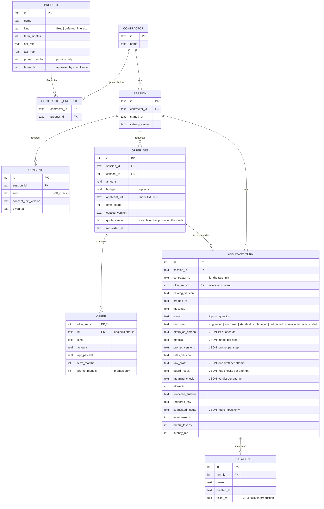

# Data model

Two kinds of data, kept apart on purpose:

- **Reference data the company already owns**: loan products, contractors and which products each offers. In production it comes from the existing catalog and contractor profile APIs. In the prototype it's mock data in code behind the same interfaces (`LoanCatalog`), so it is not stored here.
- **What the assistant service owns**: quote sessions, consent, the offers the decision engine returned, every assistant turn and every escalation. This is the audit trail compliance asked for. In the prototype it lives in SQLite (Node's built-in `node:sqlite`, one file in a Docker volume). In production the same tables live in RDS Postgres.

All service-owned tables are **append-only**: rows are inserted, never updated or deleted. In production the service's database role has no `UPDATE` or `DELETE` rights, and a nightly export goes to S3 with Object Lock.

## Schema diagram

## Tables

### Reference data (existing services; mocked in code)

| Table | What a row is | Key columns | Notes |
|---|---|---|---|
| `contractor` | A contractor partner | `id` | From the contractor profile service. Authentication is handled upstream by the portal (PRD A-4). |
| `product` | A loan product in the catalog | `kind`, `term_months`, `apr_min`/`apr_max`, `promo_months`, `terms_text` | APR is a range because it depends on credit. `terms_text` is the compliance-approved wording the assistant must use (FR-10a). |
| `contractor_product` | One product a contractor is enrolled to offer | `contractor_id`, `product_id` | The ballpark only uses these (FR-1). |

### Owned by the assistant service (the audit trail)

| Table | What a row is | Key columns | Why it exists |
|---|---|---|---|
| `session` | One quoting conversation on a tablet | `contractor_id`, `catalog_version` | Groups everything compliance needs to replay one kitchen-table conversation. The ID is generated by the service; only the contractor who opened it can use it. Holds no homeowner data. |
| `consent` | The homeowner's consent to a soft credit check | `kind`, `consent_text_version`, `given_at` | FR-4: no soft check without a consent row first. Records which wording was consented to. The contractor is the session's owner. If the check then fails, the consent row stays: it was given. |
| `offer_set` | One soft check and what it returned | `consent_id`, `amount`, `budget`, `applicant_ref`, `offer_count`, `catalog_version`, `quote_version` | Links every set of offers to the consent that allowed it, and records which catalog and calculator produced the cards. The budget is stored here but never sent to the credit engine. `applicant_ref` is a mock fixture ID; production stores the decision engine's reference, not personal data. |
| `offer` | One offer from the decision engine | key (`offer_set_id`, `id`); `kind`, `apr_percent`, `term_months`, `promo_months` | Stores the engine's decision exactly as returned. Every figure shown can be recomputed from these rows with the quote engine. |
| `assistant_turn` | One contractor message and everything that happened to it | `route`, `outcome`, `raw_draft`, `guard_result`, `meaning_check` (one entry per attempt), `rendered_*`, `models`, `prompt_versions`, `rules_version`, tokens, `latency_ms` | FR-14: "what the system said and why". Raw draft and rendered text side by side show the placeholders being filled. Tokens per turn feed cost tracking (FR-18) and the rate limit (FR-17). |
| `escalation` | A turn the guard blocked twice | `turn_id`, `reason`, `ticket_ref` | F-2: the standard explanation was shown and compliance gets a ticket (Zapier → JSM in production, logged in the prototype). |

### Not stored, on purpose

- **No homeowner personal data** before or after consent. The soft check goes to the decision engine, and the service keeps only the engine's offers and reference.
- **No figures as text.** Payments, totals and the cliff are recomputed from `offer` rows by the quote engine, so a stored number can never drift from the calculator.
- **Rate limit counters.** The limit counts a contractor's `assistant_turn` rows in the last hour (`assistant_turn.contractor_id` is copied from the session for this); production would move this to Redis.

## Prototype and production

| Concern | Prototype | Production |
|---|---|---|
| Store | SQLite file `data/assistant.db` in a Docker volume | RDS Postgres |
| Append-only | Triggers reject every `UPDATE` and `DELETE` | DB role without `UPDATE`/`DELETE`; nightly export to S3 Object Lock |
| Reference data | Mock catalog in `server/src/mocks/` | Catalog and contractor profile APIs |
| Schema source | `server/src/schema.ts` (DDL plus append-only triggers) | Same DDL through migrations |
